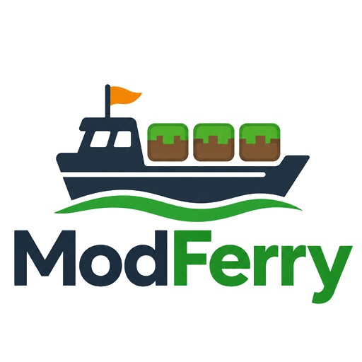
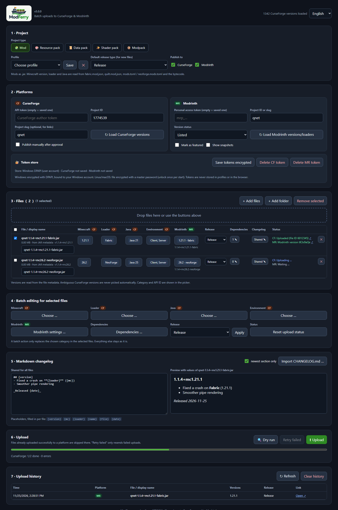

<p align="center">
  
</p>

<p align="center">
  <b>Ship many Minecraft files to CurseForge and Modrinth in one go.</b><br>
  Mods · Resource packs · Data packs · Shader packs · Modpacks
</p>

<p align="center">
  <a href="https://github.com/CptGummiball/ModFerry/actions/workflows/tests.yml"></a>
  <a href="https://github.com/CptGummiball/ModFerry/releases/latest"></a>
  <a href="LICENSE"></a>
  
  
  
  
</p>

---

ModFerry is a small **local web app** for Minecraft creators who publish the same release in many variants, e.g. one JAR per loader and Minecraft version. Drop all files in, check what ModFerry read from them, fix the rest in a table and upload everything to **CurseForge**, **Modrinth** or **both** with one click.

It runs on your own computer (`127.0.0.1`), talks only to the official CurseForge and Modrinth APIs and keeps your API tokens encrypted.



## Features

- **Five project types**: mods (`.jar`), resource packs, data packs and shader packs (`.zip`) and modpacks (`.zip` for CurseForge, `.mrpack` for Modrinth, handled separately, because the platforms use different formats).
- **Reads the metadata for you**
  - Mods: Minecraft version, loader and mod version from `fabric.mod.json`, `quilt.mod.json`, `mods.toml`, `neoforge.mods.toml`; minimum Java version from the bytecode.
  - Resource / data packs: Minecraft versions from `pack_format`, `supported_formats` or `min_format`/`max_format` in `pack.mcmeta` (incl. the new `major.minor` formats).
  - Modpacks: Minecraft version, loader and pack version from `manifest.json` / `modrinth.index.json`.
  - **Never guesses**: version ranges and ambiguous CurseForge versions are left for you to pick.
- **Batch editing**: select files and set Minecraft versions, loaders, Java, environment, release type, Modrinth settings or dependencies for all of them at once.
- **Dependencies** for both platforms (CurseForge slug/ID and Modrinth ID in one list).
- **Markdown changelog** with live preview, **placeholders** (`{version}`, `{mc}`, `{loader}`, `{name}`, `{file}`, `{date}`) and **CHANGELOG.md import** (optionally only the newest section).
- **Dry run**: shows the exact metadata that would be sent, without uploading anything.
- **Safe retries**: status is tracked per platform; files already uploaded are skipped, "Retry failed" only resends failures. Everything is validated for *both* platforms before the first byte is sent.
- **Profiles** remember a project's settings. They match files **by pattern**, so `mymod-1.4.1-fabric.jar` picks up the settings of `mymod-1.4.0-fabric.jar`.
- **Upload history** with direct links to the new files.
- **Modrinth options**: listed / unlisted / draft / archived, featured, snapshot versions.
- **CurseForge server packs**: attach a server pack to a modpack as an additional file.
- **Encrypted token store**: Windows DPAPI or a master password (Linux/macOS).
- **English and German UI**, chosen from your browser language.

## Quick start

You need **Python 3.11 or newer**.

| Windows | Linux / macOS |
|---|---|
| Download and unzip the [latest release](https://github.com/CptGummiball/ModFerry/releases/latest), then double-click **`start-windows.bat`**. | `./start-linux.sh` |

The launcher creates a virtual environment, installs the dependencies and opens **http://127.0.0.1:8765**.

Then:

1. Choose the **project type**.
2. Enter your CurseForge token + project ID and/or Modrinth token + project slug ([how to get tokens](../../wiki/Tokens-and-Security)).
3. Click **Load CurseForge versions** (and optionally **Load Modrinth versions/loaders**).
4. Add your files, check the table, write a changelog.
5. Click **Dry run**, then **Upload**.

> 💡 Do a first test with a single file, ideally as Modrinth *draft* and with CurseForge's *publish manually after approval*.

## Documentation

All details are in the **[Wiki](../../wiki)**:

[Installation](../../wiki/Installation) · [Getting started](../../wiki/Getting-Started) · [Project types](../../wiki/Project-Types) · [Version detection](../../wiki/Version-Detection) · [Batch editing & dependencies](../../wiki/Batch-Editing-and-Dependencies) · [Changelogs](../../wiki/Changelogs) · [Profiles](../../wiki/Profiles) · [Uploading, dry run & history](../../wiki/Uploading) · [Tokens & security](../../wiki/Tokens-and-Security) · [Configuration](../../wiki/Configuration) · [Troubleshooting](../../wiki/Troubleshooting) · [Development](../../wiki/Development)

## Security in short

- The server only listens on `127.0.0.1` and rejects foreign `Host`/`Origin` headers (DNS rebinding / CSRF protection). **Do not expose it to a network.**
- Tokens are encrypted at rest and never written to profiles, the browser or logs.
- Files are cached in `data/files/` only while the app runs and are deleted on the next start.

## Development

```bash
python -m venv .venv && source .venv/bin/activate   # Windows: .venv\Scripts\activate
pip install -r requirements.txt
python -m unittest discover -s tests -v
python app.py
```

No build step: the frontend is plain HTML/CSS/JS in `static/`, translations live in `static/i18n/*.json` and `messages.py`. See [Development](../../wiki/Development).

## Contributing

Issues, ideas, translations and pull requests are welcome. Please read [CONTRIBUTING.md](CONTRIBUTING.md) and the [Code of Conduct](CODE_OF_CONDUCT.md). Security problems: see [SECURITY.md](SECURITY.md).

## Kurzfassung (Deutsch)

ModFerry ist eine lokale Web-App, mit der du **viele Minecraft-Dateien auf einmal** zu **CurseForge** und/oder **Modrinth** hochlädst: Mods, Resourcepacks, Datapacks, Shaderpacks und Modpacks. Versionen, Loader und Java werden aus den Dateien gelesen (ohne zu raten), alles Weitere stellst du in einer Tabelle ein, einzeln oder per Batch. Dazu gibt es Profile, Changelog-Platzhalter, Trockenlauf, sichere Wiederholung fehlgeschlagener Uploads, einen Upload-Verlauf und verschlüsselt gespeicherte Tokens. Die Oberfläche gibt es auf Deutsch und Englisch.

**Start:** Python 3.11+ installieren, `start-windows.bat` bzw. `./start-linux.sh` ausführen, `http://127.0.0.1:8765` öffnen. Ausführliche Anleitung im [Wiki](../../wiki).

## License

[MIT](LICENSE) © CptGummiball. ModFerry is not affiliated with CurseForge, Overwolf, Modrinth or Mojang.
