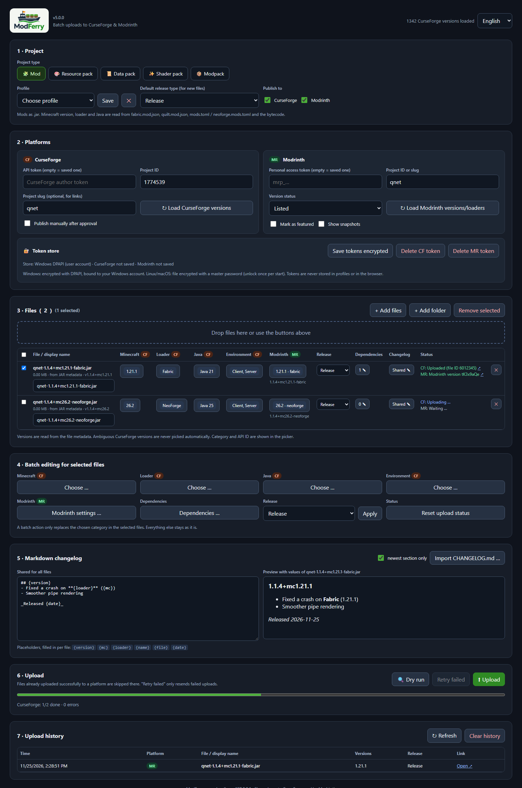

# Getting started

This walks through a typical release: one mod version, built for several loaders and Minecraft versions.

## 1. Choose the project type

Select **Mod**, **Resource pack**, **Data pack**, **Shader pack** or **Modpack**. Allowed file types and table columns adapt (see [[Project Types]]). Changing the type clears the file list.

## 2. Connect the platforms

**CurseForge**
- *API token*: create one at [authors.curseforge.com → API tokens](https://authors.curseforge.com/account/api-tokens).
- *Project ID*: the numeric ID shown in the "About Project" box of your project.
- *Project slug* (optional): the last part of your project URL. Only used to build direct links in the history.
- Click **Load CurseForge versions**. Without this list no CurseForge versions can be chosen.

**Modrinth**
- *Personal access token*: create one at [modrinth.com/settings/pats](https://modrinth.com/settings/pats) with the scope **Create versions**.
- *Project ID or slug*.
- *Version status*: `listed`, `unlisted`, `draft` or `archived`. For a first test, `draft` is a good choice.
- Click **Load Modrinth versions/loaders** to get checkbox lists in the Modrinth dialog.

Untick *CurseForge* or *Modrinth* under **Publish to** if you only use one platform.

Click **Save tokens encrypted** so you don't have to paste them again (see [[Tokens and Security]]).

## 3. Add files

Use **Add files**, **Add folder** or drag & drop. ModFerry reads the metadata of each file ([[Version Detection]]) and fills the table:

| Column | Meaning |
|---|---|
| File / display name | File name, size, where the data came from, warnings. The input field is the display name on both platforms. |
| Minecraft / Loader / Java / Environment `CF` | CurseForge game versions. Click to open the picker. A red pill means "required but missing". |
| Modrinth `MR` | Minecraft versions · loaders and the version number. Click to edit. |
| Release | release / beta / alpha per file |
| Dependencies | number of dependencies, click to edit |
| Changelog | shared or individual |
| Status | one line per platform; a ↗ link appears after a successful upload |

⚠ warnings tell you what needs a manual decision, for example a Minecraft version that exists twice on CurseForge.

## 4. Edit in batches

Tick several rows and use section **4 · Batch editing** (see [[Batch Editing and Dependencies]]).

## 5. Write the changelog

Write Markdown or import your `CHANGELOG.md`. Placeholders like `{version}` and `{mc}` are filled in per file (see [[Changelogs]]).

## 6. Dry run and upload

1. Click **🔍 Dry run**: it shows the exact metadata per file and platform and reports validation errors. Nothing is uploaded.
2. Click **⬆ Upload** and confirm. CurseForge is processed first, then Modrinth.
3. If something fails, fix it and click **Retry failed**. Successful uploads are never repeated. See [[Uploading]].

## 7. Save a profile

Click **Save** next to *Profile*. For the next release, choose the profile first, then add the new files. They are matched automatically even though the version number changed ([[Profiles]]).
