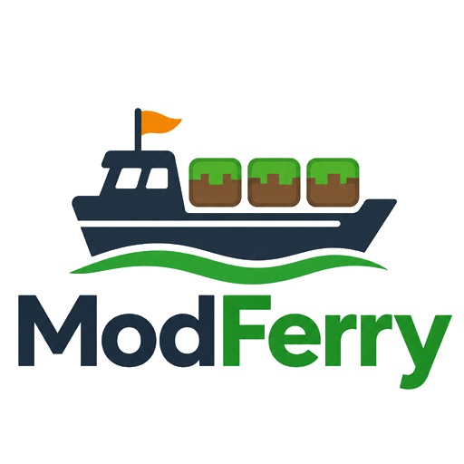

# ModFerry Wiki

ModFerry uploads many Minecraft files at once to **CurseForge** and **Modrinth**: mods, resource packs, data packs, shader packs and modpacks. It is a local web app: it runs on your computer and only talks to the official platform APIs.

## Start here

1. [[Installation]]: requirements and first start
2. [[Getting Started]]: your first upload, step by step
3. [[Tokens and Security]]: where to get API tokens and how they are stored

## Reference

- [[Project Types]]: which files go where
- [[Version Detection]]: what ModFerry reads from your files (and what it never guesses)
- [[Batch Editing and Dependencies]]
- [[Changelogs]]: Markdown, placeholders, CHANGELOG.md import
- [[Profiles]]: reuse settings for the next release
- [[Uploading]]: dry run, retries, history
- [[Configuration]]: port, data folder, files on disk
- [[Troubleshooting]]: common API errors
- [[Development]]: tests, translations, contributing

> 🇩🇪 Die Oberfläche gibt es auf Deutsch und Englisch (Sprachauswahl oben rechts). Das Wiki ist auf Englisch; eine deutsche Kurzfassung steht in der README.
